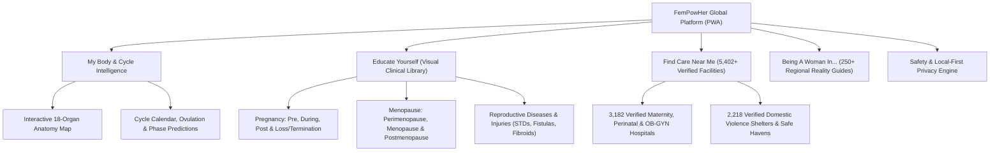

# FemPowHer — Executive Summary & Global Platform Overview

> [!IMPORTANT]
> **Built for Every Woman, Everywhere — Not Just the Western World:** Most digital women's health apps are built exclusively for high-income Western consumers with stable internet, private OB-GYN access, and retail pharmacies. **FemPowHer** is engineered from the ground up as a **global, offline-capable, local-first survival, clinical education, and care-navigation platform** for women across every country, language, literacy level, and resource setting.

---

## 1. Executive Summary (For Potential Funders & Global Health Partners)

**The Problem:**  
Globally, preventable maternal mortality, untreated reproductive diseases (such as obstetric fistulas, uterine fibroids, and STIs), and gender-based violence claim hundreds of thousands of women's lives every year. Yet existing "FemTech" platforms overwhelmingly cater to affluent Western markets—offering basic period logs behind paywalls while failing women navigating healthcare blockades, rural clinic deserts, cultural stigma, or low-resource medical systems across the Global South, Central & South Asia, Sub-Saharan Africa, Latin America, the Middle East, and Eastern Europe.

**The Solution — FemPowHer:**  
**FemPowHer** is a free, multilingual, privacy-first Progressive Web Application (PWA) that combines **visual, zero-jargon reproductive & anatomical education**, **personalised menstrual & life-stage tracking**, **country-specific legal and healthcare reality briefings**, and an **offline-capable global directory of over 5,400 verified maternity hospitals and domestic violence safe havens**—putting life-saving clinical knowledge and the nearest accessible care into every woman's hands, wherever she lives.

**Why Funders Invest in FemPowHer:**
- **Global Equity by Design:** Supports **25+ world languages** (including right-to-left scripts like Arabic, Persian/Dari, Pashto, and Urdu, alongside Swahili, Hausa, Yoruba, Amharic, Hindi, Bengali, Kazakh, Russian, Spanish, French, and Portuguese) and covers **250+ countries, territories, and sub-national regions**.
- **Immediate Care Navigation Anywhere on Earth:** Connects users to **5,402+ verified facilities** (**3,182 maternity/OB-GYN referral hospitals** and **2,218 women's crisis shelters & domestic abuse safe havens**) with one-tap emergency dialing, offline-resilient coordinates, and step-by-step routing to the closest care available.
- **Uncompromising Safety & Zero-Server Privacy:** Built with a **local-first architecture** where cycle histories, symptom logs, and emergency contacts remain strictly on the user's device (with instant one-tap **Quick Exit** decoy/escape functionality and optional anonymous mode) so women in restrictive jurisdictions can never be surveilled or subpoenaed.

---

## 2. Core Platform Architecture & Capabilities

### A. Visual, Stigma-Free Body & Reproductive Health Education (`My Body` & `Educate Yourself`)
Women around the world are routinely denied clear information about their own anatomy and the medical conditions affecting them. FemPowHer bridges literacy and language barriers through rich, custom-illustrated visual education:
- **Interactive Female Anatomy Explorer (`My Body`):** A touch-interactive anatomical map covering **18 internal and external reproductive structures** (Uterus, Uterine Lining, Fallopian Tubes, Ovaries & Follicles, Egg/Ovum, Cervix, Vaginal Canal, Clitoris, Labia Majora/Minora, Breasts, Mammary Glands, Nipple/Areola, Milk Ducts, Lobules, etc.), linking each organ directly to its function, cyclical changes, and clinical pathologies.
- **Full-Spectrum Life-Stage & Clinical Guides (`Educate Yourself`):**
  - **Pregnancy Hub:** Comprehensive modules for *Pre-Pregnancy*, *During Pregnancy*, *Post-Pregnancy (Postpartum)*, and *Failed & Aborted Pregnancy* (miscarriage, ectopic pregnancy, stillbirth, and safe post-abortion care).
  - **Menopause Hub:** Dedicated clinical guides for *Perimenopause*, *Menopause*, and *Postmenopause*—demystifying hormonal transitions, bone/cardiovascular health, and symptom management.
  - **Reproductive Health Diseases & Injuries & Sexual Health:** Visual, accessible guides covering **Sexually Transmitted Diseases (STDs)**, **Obstetric & Pelvic Fistulas** (a devastating, preventable childbirth injury disproportionately affecting women in low-resource settings), **Uterine Fibroids**, endometriosis, PCOS, and reproductive cancers.

### B. Global Care & Safe Haven Navigation (`Find Care`)
Whether a user is in rural Mozambique, Almaty, Lagos, Lima, Kabul, or Boston, FemPowHer locates the **closest verified medical and crisis resources**:
- **3,182 Maternity, Perinatal & OB-GYN Referral Hospitals:** Vetted public and charity maternity hospitals, perinatal centers, emergency C-section units, and fistula repair hospitals across every continent.
- **2,218 Women's Safe Havens & Crisis Shelters:** Domestic violence shelters, gender-based violence (GBV) crisis centers, legal aid sanctuaries, and mother-and-baby shelters (`Дом Мамы` / `Ana Uyi`, GNWS-verified shelters, etc.).
- **Country-Specific Emergency Hotlines & Personal Emergency Contacts:** Automatically surfaces local ambulance, police, and national 24/7 GBV/maternal crisis hotlines alongside the user's personal emergency contacts.

### C. Country-Specific Realities (`Being A Woman In...`)
A woman's reproductive health is inseparable from the laws, infrastructure, and cultural realities of where she lives.
- **250+ Country & Regional Profiles:** Contextualizes maternal healthcare access, legal rights, domestic violence protections, cultural barriers, and practical survival strategies tailored to the user's selected nation or region.

### D. Personalized Menstrual Cycle & Symptom Tracking (`My Cycle`)
- **Adaptive Cycle Calendar:** Tracks period start/end dates, flow intensity, ovulation windows, fertile days, and cycle phases (*Menstrual*, *Follicular*, *Ovulation*, *Luteal*) with full user control over data persistence (`Anonymous` zero-retention mode vs. persistent local account storage with one-click `Clear Calendar`).

---

## 3. Vision for Expansion: Low-Resource Survival & Maternal Mortality Prevention

> [!TIP]
> **Strategic Growth Roadmap:** With funder support, FemPowHer is expanding beyond care-finding and education into **field-ready, low-resource clinical survival toolkits** designed directly to prevent maternal and reproductive deaths when formal supply chains or hospitals fail.

1. **Low-Resource Maternal Hemorrhage & Childbirth Survival Tools:**
   - Adding actionable guides on what tools are needed to stop preventable maternal deaths in low-resource births—and how to improvise them locally when commercial medical supplies (such as calibrated postpartum hemorrhage blood-collection drapes/pouches) are unavailable or unaffordable, by mapping locally accessible household equivalents (e.g., standard local measuring vessels or craftable calibrated collection tools in rural communities).
2. **Crisis & Supply-Shortage Surgical Preparedness Checklists (e.g., Emergency C-Section & Delivery Kits):**
   - Equipping women and families in healthcare-fragile or blockaded settings (such as Cuba, Afghanistan, or conflict zones where patients must procure their own surgical supplies before admission) with exact, prioritized checklists of what sterile supplies, sutures, antibiotics, IV fluids, and analgesics to gather ahead of a C-section or hospital birth.
3. **Safe, Hygienic DIY Menstrual Product Crafting:**
   - Providing step-by-step, medically vetted visual instructions for crafting, sterilizing, and safely reusing menstrual pads and absorbent materials from locally available textiles in areas experiencing period poverty, displacement, or supply chain collapse.
4. **Offline Mesh Distribution & Community Health Worker (CHW) Mode:**
   - Expanding offline caching and peer-to-peer sharing so midwives, doulas, and community health workers in zero-connectivity regions can carry the entire FemPowHer clinical library, survival toolkits, and regional referral maps on any low-cost smartphone.

---

## 4. Summary of Platform Metrics at a Glance

| Pillar | Current Live Capability |
| :--- | :--- |
| **Verified Global Facilities** | **5,402 total** (3,182 Maternity/OB-GYN Hospitals + 2,218 Women's Safe Havens) |
| **Geographic Coverage** | **250+ Countries, Territories & Sub-National Regions** across all 6 inhabited continents |
| **Language Accessibility** | **25+ Languages** with full RTL support and dynamic in-app translation (`UserLanguageChoice1`) |
| **Interactive Anatomy & Clinical Modules** | **18 Interactive Anatomical Organs** + dedicated hubs for Pregnancy, Menopause, STDs, Fistulas & Fibroids |
| **Privacy & Safety Architecture** | **100% Local-First (Zero Cloud Tracking)** + Instant `Quick Exit` Escape Bar + Optional Anonymous Mode |
